# PROJECT CONTEXT: AI-Based Traffic Management System

## 1. Purpose & Scope
The **AI-Based Traffic Management System** is a multi-paradigm intelligent transportation project designed to replace rigid, fixed-timer urban traffic signals with dynamic, congestion-aware signal allocation at 4-way intersections. It combines computer vision (**YOLOv8** vehicle detection and priority scoring across `car`, `motorcycle`, `bus`, and `truck`), reinforcement learning (a 1,024-state **Tabular Q-Learning** agent that minimizes vehicle waiting times under asymmetric Poisson arrival rates), and a real-time multithreaded **Pygame 2D physics simulation** with vehicle turning, collision avoidance, and anti-starvation signal overrides.

---

## 2. Architecture Overview

### High-Level Component Diagram

```mermaid
flowchart TD
    subgraph Vision & Heuristic Allocation Module
        Img[4 Intersection Lane Images: set1/] -->|File Dialog Input| Main[Object Detection: main.py]
        Weights[(YOLOv8 Medium: yolov8m.pt)] --> Main
        Main -->|Class Filter & Priority Weights| PriorityScore[Priority Calculation: Truck 4, Bus 3, Car 2, Bike 1]
        PriorityScore -->|Import main| TkinterGUI[Signal Duration Dashboard: trafficsignal.py]
        TkinterGUI -->|Display Green Durations 10s-30s| UI1[Tkinter 2x2 Window]
    end

    subgraph Reinforcement Learning Module
        Env[TrafficIntersectionEnv: QLearning.py] -->|Discrete State 1024| Agent[QLearningAgent: QLearning.py]
        Agent -->|Action 0-3: Select Green Road| Env
        Env -->|Poisson Arrivals & Clearing| StepEval[Waiting Time & Starvation Penalties]
        StepEval -->|Reward Signal| Agent
        Agent -->|Bellman Updates| QTable[(Saved Weights: q_table.npy)]
        Agent -->|Evaluation Mode| BaselineCmp[Comparative Eval vs Round-Robin Baseline]
    end

    subgraph Multithreaded 2D Physics Simulation Module
        ThreadGen[Thread: generateVehicles] -->|Spawn Random Sprites| VehiclesDict[(Shared Dict: vehicles)]
        ThreadTiming[Thread: setTime] -->|Poll VehicleCounter Priorities| SignalsList[(Shared List: signals)]
        ThreadTimer[Thread: simulationTime] -->|6000s Sim Clock| GlobalClock[timeElapsed]
        
        SignalsList -->|Starvation Check >50s OR Max Priority| SignalState[Green / Yellow / Red Transitions]
        VehiclesDict -->|Collision Distance & Stopline Math| PygameLoop[Main Thread: Pygame Render Loop]
        SignalState --> PygameLoop
        PygameLoop -->|1400x800 Canvas| Screen[2D Intersection Window: final.py]
    end
```


### Inter-Component Communication Mechanisms
1. **Module Independence**: The codebase is architected as three standalone subsystems: (1) Computer Vision & Priority Timing, (2) Q-Learning RL Optimization, and (3) Multithreaded Pygame Simulation.
2. **Direct Module Import Coupling**: `Object Detection/src/trafficsignal.py` directly executes `import main`, reading the global list `main.total_priorities_per_image` computed during `main.py` top-level script execution.
3. **Shared Memory Multithreading**: `Simulation/final.py` uses shared global dictionaries (`vehicles`, `x`, `y`, `stops`, `stopLines`) and global lists (`signals`) accessed concurrently across 4 daemon threads (`timing`, `initialization`, `generateVehicles`, `simulationTime`) and the main Pygame drawing loop.
4. **Binary Serialization**: `Q-Learning model/src/QLearning.py` persists its $1024 \times 4$ Q-matrix directly to disk via `np.save()` / `np.load()` as `q_table.npy`.

### State Lifecycle and Flow
- **Vision State**: Captured lane images $\rightarrow$ YOLOv8 bounding boxes $\rightarrow$ Counter dictionary of detected target vehicles $\rightarrow$ Integer priority score per lane $\rightarrow$ Discretized green time tiers (10s, 15s, 20s, 25s, 30s).
- **Simulation State**: Stored in global memory (`vehicles[direction][lane]` storing `Vehicle` sprite objects, `signals[0..3]` storing `TrafficSignal` state machines). Vehicles transition through states: Spawning $\rightarrow$ Moving $\rightarrow$ Decelerating $\rightarrow$ Stopping $\rightarrow$ Crossing stopline $\rightarrow$ Turning (angular interpolation 0° to 90°) $\rightarrow$ Exiting.
- **RL State**: Encoded as a discrete integer $s \in [0, 1023]$ where $s = b_0 \cdot 256 + b_1 \cdot 64 + b_2 \cdot 16 + b_3 \cdot 4 + \text{green}$, with queue bins $b_i \in \{0, 1, 2, 3\}$ (empty, low, medium, high).

---

## 3. Tech Stack & Why

| Technology | Version / Spec | Purpose & Architectural Justification |
| :--- | :--- | :--- |
| **Python** | 3.8+ (tested on 3.11.9) | Core language for computer vision, reinforcement learning, and game simulation. |
| **Ultralytics YOLOv8** | `ultralytics==8.0.199` | Real-time object detection model (`yolov8m.pt`). Chosen for state-of-the-art inference speed and accuracy on COCO vehicle classes (`car`, `motorcycle`, `bus`, `truck`). |
| **OpenCV** | `opencv-python==4.7.0.72` | Image loading, resizing (1020x500 standard input), bounding box rendering, and window display. |
| **cvzone** | `cvzone==1.6.1` | High-level OpenCV helper for clean bounding box labels and text rendering overlays. |
| **Pygame** | `pygame==2.3.0` | 2D graphical game engine. Powers the 1400x800 intersection simulation, sprite management, sprite rotation, and physics updates. |
| **NumPy** | `numpy==1.24.3` | Matrix operations, tabular Q-table manipulation, Poisson random sampling, and `.npy` serialization. |
| **Pandas** | `pandas==2.0.1` | Converts YOLOv8 bounding box tensor outputs to structured DataFrames for filtering and iteration. |
| **Tkinter** | Standard Library | GUI toolkit for file dialog prompts (`askopenfilename`) and 2x2 grid signal allocation dashboards. |
| **PyTorch / Torchvision** | `torch>=1.10.0` | Deep learning backend executing YOLOv8 model inference on CPU or CUDA GPU. |

---

## 4. Directory & Module Map

```
AI-Based-Traffic-Management-System/
├── README.md                           # Comprehensive project overview & quickstart guide
├── requirements.txt                    # Python package dependencies
├── PROJECT_REPORT.md                   # Technical analysis & architectural breakdown
├── Object Detection/                   # Computer Vision & Priority Timing Module
│   ├── set1/                           # Sample lane images (lane1.jpg, Lane2.jpg, Lane3.png, Lane4.jpg, trucks.jpg)
│   └── src/
│       ├── classes.txt                 # COCO dataset 80 class labels index
│       ├── main.py                     # YOLOv8 inference, vehicle counting, priority computation & image display
│       └── trafficsignal.py            # Tkinter 2x2 dashboard displaying calculated green times (imports main.py)
├── Q-Learning model/                   # Reinforcement Learning Module
│   ├── Q_LEARNING_README.md            # Detailed Q-Learning theory, reward math, and usage guide
│   └── src/
│       ├── QLearning.py                # TrafficIntersectionEnv, QLearningAgent, training loop, evaluation CLI
│       └── q_table.npy                 # Serialized pre-trained 1024x4 Q-table matrix
└── Simulation/                         # Multithreaded 2D Pygame Simulation Module
    ├── final.py                        # Pygame 4-way intersection simulation, vehicle physics & signal threads
    └── images/                         # Graphical assets (mod_int.png, signals/red.png, vehicle sprites)
        ├── intersection.png / mod_int.png
        ├── signals/ (red.png, yellow.png, green.png)
        ├── right/ (car.png, bus.png, truck.png, bike.png, rickshaw.png)
        ├── down/ (car.png, bus.png, truck.png, bike.png, rickshaw.png)
        ├── left/ (car.png, bus.png, truck.png, bike.png, rickshaw.png)
        └── up/ (car.png, bus.png, truck.png, bike.png, rickshaw.png)
```

### Module Responsibilities & Misleading Name Flags
- **`Object Detection/src/main.py`**: Executes YOLOv8 detection on 4 user-selected images, draws bounding boxes, and computes cumulative vehicle priority per image.
- **`Object Detection/src/trafficsignal.py`**: Tkinter UI wrapper for green time allocation. *(Flag: Misleading Coupling — importing this file immediately runs the interactive file dialogs and OpenCV windows in `main.py`)*.
- **`Q-Learning model/src/QLearning.py`**: Self-contained RL module implementing environment, tabular agent, Bellman updates, Poisson vehicle generation, starvation penalties, and evaluation comparison.
- **`Simulation/final.py`**: The complete Pygame intersection simulator. *(Flag: Misleading name — `final.py` is not a build artifact, but the primary simulation application)*.
- **`Simulation/images/`**: Direction-specific sprite folders (`right/`, `down/`, `left/`, `up/`) containing pre-rotated vehicle assets.

---

## 5. Critical Files (The Load-Bearing Core)

### 1. `c:\Files\Coding\Projects\AI-Based-Traffic-Management-System\Object Detection\src\main.py`
- **Why it's critical**: Core computer vision engine. Loads YOLOv8, detects traffic objects, filters non-vehicle classes, and computes weighted priority scores.
- **Key Functions/Classes**:
  - `object_detc(feed)`: Runs `model.predict(feed)`, converts detections to a pandas DataFrame, draws magenta bounding boxes `(255, 0, 255)`, overlays class text via `cvzone`, and returns detected class names.
  - `CountObInImg(classes_list)`: Filters detection results using `collections.Counter` for `["car", "motorcycle", "bus", "truck"]`.
  - `CalculateTotalPriority(count_dict)`: Computes $\sum (\text{count} \times \text{weight})$ with weights `truck: 4`, `bus: 3`, `car: 2`, `motorcycle: 1`.
  - Top-level loop: Prompts user 4 times via `filedialog.askopenfilename`, resizes images to `(1020, 500)`, calls detection, displays OpenCV windows, and populates `total_priorities_per_image`.
- **Non-Obvious Details**:
  - Automatically falls back to downloading `"yolov8m.pt"` from the Ultralytics cloud if the local weights file is not in `src/`.
  - Has un-guarded top-level execution code (no `if __name__ == '__main__':`), which causes side effects when imported by other modules.

### 2. `c:\Files\Coding\Projects\AI-Based-Traffic-Management-System\Object Detection\src\trafficsignal.py`
- **Why it's critical**: Translates numerical vision priority scores into actionable green signal duration allocations in a GUI.
- **Key Functions/Classes**:
  - `calculate_green_time(priority)`: Threshold mapping function:
    - $\text{priority} = 0 \rightarrow 10\text{s}$ (minimum)
    - $\text{priority} < 10 \rightarrow 15\text{s}$
    - $\text{priority} < 20 \rightarrow 20\text{s}$
    - $\text{priority} < 30 \rightarrow 25\text{s}$
    - $\text{priority} \ge 30 \rightarrow 30\text{s}$ (maximum)
  - Tkinter grid initialization: Builds a 2x2 grid frame displaying Lane number, Priority score, and Green Signal duration in seconds.
- **Non-Obvious Details**:
  - Line 3 (`import main`) triggers the entire 4-image selection and YOLO detection loop synchronously before the Tkinter window is constructed.

### 3. `c:\Files\Coding\Projects\AI-Based-Traffic-Management-System\Simulation\final.py`
- **Why it's critical**: The multi-threaded Pygame visualization and traffic physics simulator. Manages vehicle movement, turning dynamics, car-following spacing, signal timing, and starvation prevention.
- **Key Functions/Classes**:
  - `Vehicle(pygame.sprite.Sprite)`: Controls vehicle coordinates, speed, rotation during turns, distance-to-stopline calculations, and sprite rendering.
  - `Vehicle.get_leading_vehicle_distance()`: Car-following distance calculator; detects preceding vehicle in the same lane and dynamically bounds deceleration.
  - `Vehicle.move()`: Coordinates distance-to-stopline deceleration, safe distance maintenance (`safe_distance = 35`), signal stop compliance, and direction-specific handlers (`__handle_right_movement`, `__handle_down_movement`, etc.).
  - `VehicleCounter`: Class providing helper methods (`getBikeCount`, `getCarCount`, `getRickshawCount`, `getBusCount`, `getTruckCount`) for uncrossed vehicles per direction.
  - `TrafficSignal`: Class managing signal state variables (`red`, `yellow`, `green`, `totalGreenTime`, `totalRedTime`, `priority`).
  - `TrafficSignal.updatePriorities()`: Static priority calculator (`bike: 1`, `car: 2`, `rickshaw: 2`, `bus: 3`, `truck: 3`).
  - `setTime()`: Signal controller thread loop. Enforces `min_green_time = 10s`, transitions through `defaultYellow = 5s`, and forces a 15s green phase if any lane exceeds `max_red_time = 50s` (starvation guard).
  - `generateVehicles()`: Vehicle spawner thread loop. Spawns random vehicles every 1.2s across directions 0–3 and lanes 0–2.
  - `Main()`: Pygame display loop controller (1400x800 window at `images/mod_int.png`).
- **Non-Obvious Details**:
  - Vehicles in lane 2 have a random 60% probability (`temp <= 2` out of 0..4) of executing a 90-degree right turn at the intersection midpoint (`mid`).
  - Vehicles calculate collision distance based on rotated bounding box dimensions (`currentImage.get_rect().height` vs `width`) once rotated $\ge 45^\circ$.
  - Signal transitions sleep the timing thread using `time.sleep()`, during which `updateValues()` is paused, causing signal countdowns to hold steady during yellow intervals.

### 4. `c:\Files\Coding\Projects\AI-Based-Traffic-Management-System\Q-Learning model\src\QLearning.py`
- **Why it's critical**: Core reinforcement learning module. Formulates traffic signal optimization as a Markov Decision Process (MDP) and trains an agent to minimize waiting time under asymmetric Poisson vehicle arrivals.
- **Key Functions/Classes**:
  - `TrafficIntersectionEnv`: Simulation environment with 1,024 discrete states ($4^4 \text{ queue bins} \times 4 \text{ current green phases}$).
  - `TrafficIntersectionEnv.step(action, arrivals)`: Clears up to 5 vehicles from the green road, adds Poisson arrivals `[3.0, 1.0, 2.5, 1.0]`, updates waiting times (+30s for red roads, reset to 0 for green), and calculates composite reward.
  - `TrafficIntersectionEnv._discretize_queue(queue_size)`: Bins continuous queue sizes into 0 (empty: 0), 1 (low: 1-3), 2 (medium: 4-8), 3 (high: 9+).
  - `QLearningAgent`: Tabular Q-Learning agent with $\epsilon$-greedy action selection and Bellman equation updates:
    $$Q(s, a) \leftarrow Q(s, a) + \alpha [r + \gamma \max_{a'} Q(s', a') - Q(s, a)]$$
  - `train(episodes, steps_per_episode)`: Runs training loop over 2,000 episodes (200 steps each), decays $\epsilon$ from 1.0 to 0.01, tracks convergence metrics, and saves `q_table.npy`.
  - `evaluate(agent, num_steps)`: Compares the trained agent against a round-robin baseline using identical seeded Poisson arrival schedules across total reward, average wait time, vehicles cleared, and queue size.
  - `analyze_q_table(agent)`: Diagnostic tool inspecting state visitation coverage and preferred action distributions.
- **Non-Obvious Details**:
  - The arrival rate sum (7.5 vehicles/step) intentionally exceeds the clearance capacity (5.0 vehicles/step), forcing the agent to prioritize congested roads rather than cycling symmetrically.
  - Evaluates pre-clear queues to award an extra $+2.0$ reward bonus when the agent chooses the road with the single highest queue.

```
PASTE THESE FILES VERBATIM:
- c:\Files\Coding\Projects\AI-Based-Traffic-Management-System\Object Detection\src\main.py
- c:\Files\Coding\Projects\AI-Based-Traffic-Management-System\Object Detection\src\trafficsignal.py
- c:\Files\Coding\Projects\AI-Based-Traffic-Management-System\Simulation\final.py
- c:\Files\Coding\Projects\AI-Based-Traffic-Management-System\Q-Learning model\src\QLearning.py
```

---

## 6. Data & Control Flow (End-to-End)

### Flow 1: Vision-Based Dynamic Signal Duration Allocation
```
[1] User runs Object Detection/src/trafficsignal.py
    │
    ▼
[2] trafficsignal.py executes: import main
    │
    ├──> [2.1] main.py initializes YOLO("yolov8m.pt") and loads classes.txt
    │
    ├──> [2.2] Loops i = 0..3: Opens Tkinter filedialog.askopenfilename()
    │    ├── User selects lane image (e.g. Object Detection/set1/lane1.jpg)
    │    ├── cv2.imread() loads image -> Resized to (1020, 500)
    │    ├── object_detc(feed) -> YOLOv8 predicts bounding boxes
    │    ├── Filter detections in CountObInImg() -> {"car": 4, "bus": 1, "truck": 1, "motorcycle": 2}
    │    ├── CalculateTotalPriority() -> (4*2) + (1*3) + (1*4) + (2*1) = 17
    │    ├── Appends priority (17) to total_priorities_per_image
    │    └── cv2.imshow("Image 1", feed) renders annotated frame
    │
    └──> [2.3] cv2.waitKey(0) blocks until user presses 'q' -> cv2.destroyAllWindows()
    │
    ▼
[3] Control returns to trafficsignal.py:
    │
    ├──> Iterates enumerate(main.total_priorities_per_image):
    │    ├── Priority 17 -> calculate_green_time(17) -> returns 20 seconds
    │    └── Creates Tkinter Frame & Label: "Lane 1 \n Priority: 17 \n Green Time: 20 seconds"
    │
    ▼
[4] root.mainloop() renders 2x2 Tkinter dashboard on screen
```

### Flow 2: Multithreaded Pygame Simulation Execution
```
[1] User runs Simulation/final.py -> Main() initialized
    │
    ├──> Spawns Thread 1: simulationTime() (Counts timeElapsed every 1s)
    ├──> Spawns Thread 2: initialize() -> Appends 4 TrafficSignal objects -> Spawns setTime()
    ├──> Spawns Thread 3: generateVehicles() -> Randomly creates Vehicle() sprites every 1.2s
    │
    ▼
[2] Concurrent Thread: setTime() Loop:
    │
    ├──> Calls TrafficSignal.updatePriorities() -> Queries VehicleCounter for uncrossed vehicle counts
    ├──> Priority calculation: bike*1 + car*2 + rickshaw*2 + bus*3 + truck*3
    ├──> Check Starvation: Is any red signal totalRedTime >= 50s?
    │    ├── YES -> Force yellow transition (5s) -> Give forced green (15s) to starving lane
    │    └── NO  -> Check if current green totalGreenTime >= 10s AND another lane has higher priority
    │               └── YES -> Trigger yellow (5s) -> Switch currentGreen to highest priority lane
    └──> Calls updateValues() -> Decrements timers every 1 second
    │
    ▼
[3] Main Thread: Pygame Render Loop (60 FPS):
    │
    ├──> blit(background, (0,0))
    ├──> Render signal graphics (red/yellow/green sprites) & Priority text ("P: 24")
    ├──> Render vehicle counter text per direction
    └──> For each vehicle in simulation sprite group:
         ├── vehicle.move() -> Computes distance to stopline & leading vehicle distance
         ├── Applies deceleration if approaching red signal or leading vehicle
         ├── Interpolates rotation angle if turning in lane 2 (x += 2, y += 1.8, rotate 3 deg)
         └── blit(vehicle.currentImage, (vehicle.x, vehicle.y))
```

### Flow 3: Tabular Q-Learning Step & Bellman Update
```
[1] Environment Reset: TrafficIntersectionEnv.reset()
    │
    └── Queues initialized randomly (0-7 vehicles), waiting times = 0, state s = _get_state() (0-1023)
    │
    ▼
[2] Action Selection: QLearningAgent.choose_action(s)
    │
    └── Epsilon-greedy: If rand() < epsilon -> random action (0-3); else -> argmax(Q[s])
    │
    ▼
[3] Step Execution: TrafficIntersectionEnv.step(action)
    │
    ├──> Deduct switch penalty (-2) if action != current_green
    ├──> Clear min(queue[action], 5) vehicles from green road
    ├──> Add Poisson-distributed vehicle arrivals to all 4 roads
    ├──> Update waiting times: Red roads += 30s; Green road = 0s
    ├──> Calculate penalties: -(total_waiting/100) - (total_queue/10) - (starvation_penalty/100)
    ├──> Add clearing bonus: (cleared * 0.5) + (2.0 if action was highest queue road)
    └──> Encode next state s'
    │
    ▼
[4] Learning Update: QLearningAgent.learn(s, a, r, s')
    │
    ├──> td_target = r + gamma * max(Q[s'])
    ├──> td_error = td_target - Q[s, a]
    └──> Q[s, a] += alpha * td_error
```

---

## 7. Configuration & Environment

### Configuration Parameters Across Modules

#### 1. Vision & Priority Constants (`Object Detection/src/`)
- `weights_path`: `"yolov8m.pt"` (auto-downloaded by Ultralytics if absent).
- `classes_path`: `Object Detection/src/classes.txt` (COCO 80 class labels).
- `priority_values`: `{"truck": 4, "bus": 3, "car": 2, "motorcycle": 1}`.
- `input_resolution`: `(1020, 500)` pixels for YOLO inference.
- `green_time_thresholds`: 0 $\rightarrow$ 10s, <10 $\rightarrow$ 15s, <20 $\rightarrow$ 20s, <30 $\rightarrow$ 25s, $\ge 30 \rightarrow$ 30s.

#### 2. Simulation Constants (`Simulation/final.py`)
- Screen Dimensions: `1400 x 800` pixels.
- `defaultRed`: `120s`, `defaultYellow`: `5s`, `defaultGreen`: `15s`, `defaultMinimum`: `10s`, `defaultMaximum`: `60s`.
- `max_red_time` (Starvation threshold): `50s`.
- Vehicle Speeds: `{'car': 2, 'bus': 1.8, 'truck': 1.8, 'rickshaw': 2, 'bike': 2.5}`.
- Vehicle Priority: `{'bike': 1, 'car': 2, 'rickshaw': 2, 'bus': 3, 'truck': 3}`.
- Vehicle Spacing: `gap = 25` (stopping gap), `gap2 = 35` (moving gap), `stopping_distance = 50`.
- Stopline Coordinates: `{'right': 590, 'down': 330, 'left': 800, 'up': 535}`.

#### 3. Q-Learning Hyperparameters (`Q-Learning model/src/QLearning.py`)
- State Space: `1,024` states ($4^4 \times 4$).
- Action Space: `4` actions (Roads 0, 1, 2, 3).
- Queue Discretization Edges: `[0, 3, 8, 15]` (Empty: 0, Low: 1-3, Medium: 4-8, High: 9+).
- Arrival Rates ($\lambda$ per road): `[3.0, 1.0, 2.5, 1.0]`.
- Clearing Capacity: `5` vehicles per green step.
- `GREEN_DURATION`: `30s`, `MAX_QUEUE_SIZE`: `20`, `STARVATION_THRESHOLD`: `120s`, `SWITCH_PENALTY`: `2`.
- RL Defaults: `episodes = 2000`, `steps_per_episode = 200`, `lr (\alpha) = 0.1`, `gamma (\gamma) = 0.95`, `epsilon_decay = 0.997`, `epsilon_min = 0.01`.

---

## 8. External Interfaces

1. **Ultralytics Weights Repository**: `https://github.com/ultralytics/assets/releases/download/v8.2.0/yolov8m.pt` (automatically fetched on first inference if missing).
2. **OpenCV HighGUI Windows**: `cv2.imshow` renders individual windows (`"Image 1"`, `"Image 2"`, etc.) for visual validation.
3. **Tkinter Desktop Window**: System native window rendering the 2x2 signal timing allocation grid.
4. **Pygame Display Surface**: Hardware-accelerated 2D surface (`pygame.display.set_mode((1400, 800))`).
5. **NumPy Binary File (`q_table.npy`)**: $1024 \times 4$ float64 array storing Q-values.

---

## 9. Build, Run, Test, Deploy

### Environment Setup
```bash
# 1. Activate Python virtual environment
python -m venv venv
# Windows:
.\venv\Scripts\Activate.ps1
# Linux/macOS:
source venv/bin/activate

# 2. Install dependencies
pip install -r requirements.txt
```

### Running Module 1: Object Detection & Priority Calculation
```bash
cd "Object Detection/src"
python main.py
# File dialog will prompt to select 4 images (use sample images in Object Detection/set1/)
# Press 'q' on OpenCV windows to exit
```

### Running Module 2: Traffic Signal Duration Dashboard
```bash
cd "Object Detection/src"
python trafficsignal.py
# Runs detection on 4 images and displays the Tkinter 2x2 duration allocation window
```

### Running Module 3: Q-Learning Reinforcement Learning
```bash
cd "Q-Learning model/src"

# Option A: Train agent (2000 episodes) and run evaluation vs round-robin
python QLearning.py

# Option B: Evaluate pre-trained q_table.npy without re-training
python QLearning.py --demo-only

# Option C: Custom training episodes with verbose logging
python QLearning.py --episodes 5000 --verbose --eval-steps 100
```

### Running Module 4: 2D Pygame Intersection Simulation
```bash
cd Simulation
python final.py
```

### Test Suite Status
- The repository does not currently use an automated `pytest` test suite. Validation is performed via:
  - Synthetic RL convergence tracking and baseline comparative evaluation (`QLearning.py --demo-only`).
  - Interactive Pygame physics execution (`Simulation/final.py`).
  - Visual bounding box inspection on sample test images (`Object Detection/set1/`).

---

## 10. Design Decisions & Trade-offs

1. **Decoupled Three-Pillar Architecture (Trade-off: Modularity vs. Unified End-to-End Execution)**:
   - *Decision*: Separate Computer Vision, Q-Learning, and Pygame Simulation into independent execution scripts.
   - *Rationale*: Allows researchers and developers to test, train, and benchmark computer vision models and RL policies independently without requiring a running game simulation.
2. **Tabular Q-Learning vs. Deep Q-Networks (DQN) (Trade-off: Simplicity/Interpretability vs. Continuous State Granularity)**:
   - *Decision*: Discretize traffic queue levels into 4 bins per road ($4^4 \times 4 = 1,024$ total states) and use tabular Q-learning.
   - *Rationale*: Tabular representations guarantee fast convergence within minutes on CPU without GPU overhead, allow direct inspection of all 1,024 policy actions, and avoid deep neural network instability.
3. **Dual Starvation Prevention Mechanisms**:
   - *Simulation (`final.py`)*: Hard 50-second timeout (`max_red_time = 50`) forces a 15-second green phase regardless of other lane queues.
   - *RL Environment (`QLearning.py`)*: Soft continuous penalty scaling above 120 seconds (`(waiting_time - 120) * 2`).
   - *Rationale*: Ensures fairness in urban traffic where low-density side streets would otherwise be starved indefinitely by heavy main-artery traffic.
4. **Pre-Rotated Directional Sprites vs. Dynamic Runtime Rotation**:
   - *Decision*: `Simulation/images/` contains pre-rendered directional folders (`right/`, `down/`, `left/`, `up/`) for base sprites, reserving runtime dynamic rotation (`pygame.transform.rotate`) strictly for active turning maneuvers.
   - *Rationale*: Significantly reduces CPU sprite blitting overhead during straight-line travel.

---

## 11. Known Issues, TODOs, Fragile Areas

1. **`trafficsignal.py` Import Side-Effect**:
   - *Fragile Area*: `trafficsignal.py` executes `import main`. Because `main.py` lacks an `if __name__ == '__main__':` guard, importing `trafficsignal` forces the user to select 4 images via file dialogs and view OpenCV windows before constructing the Tkinter GUI.
2. **Working Directory Dependency**:
   - *Fragile Area*: `Simulation/final.py` loads images using relative paths (`pygame.image.load('images/mod_int.png')`). Running `python Simulation/final.py` from the project root fails unless the current working directory is `Simulation/`.
3. **Thread Synchronization and `time.sleep()` in Simulation**:
   - *Fragile Area*: `Simulation/final.py` uses `time.sleep()` inside the `setTime()` timing thread. During the 5-second yellow interval, `updateValues()` is paused, causing signal countdown numbers to freeze.
4. **Absence of Unit Tests**:
   - *Fragile Area*: There are no formal automated unit tests verifying coordinate math, queue discretization edge cases, or priority calculations.

---

## 12. "If You Wanted To..." — Common Modification Scenarios

### Scenario 1: Connect YOLO Detection Directly to Pygame Simulation
- **Goal**: Feed real vehicle counts detected from live camera images into `Simulation/final.py` instead of using the random spawner (`generateVehicles`).
- **Files to touch**:
  - `Object Detection/src/main.py`: Refactor into a callable class `VehicleDetector` with method `detect_counts(image_path_or_frame) -> dict`. Wrap CLI script in `if __name__ == '__main__':`.
  - `Simulation/final.py`:
    - Replace `thread3 = threading.Thread(target=generateVehicles)` with a vision polling thread.
    - Call `VehicleDetector.detect_counts()` on intersection lane camera feeds.
    - Spawn vehicles in `vehicles[direction][lane]` matching the exact detected counts per vehicle type.

### Scenario 2: Upgrade Tabular Q-Learning to a Deep Q-Network (DQN) with PyTorch
- **Goal**: Handle continuous queue sizes, vehicle speeds, and emergency vehicle flags without state discretization.
- **Files to touch**:
  - `Q-Learning model/src/QLearning.py`:
    - Define a `DQN(nn.Module)` network with input layer (size 5 for continuous queues + green phase), two hidden layers (64x64 ReLU), and output layer (4 actions).
    - Implement a `ReplayBuffer` and `TargetNetwork` with $\epsilon$-greedy exploration.
    - Update `learn()` to sample mini-batches and compute MSE loss between predicted Q-values and Bellman targets.
    - Replace `q_table.npy` with `torch.save(model.state_dict(), "dqn_weights.pt")`.

### Scenario 3: Add Emergency Vehicle Preemption (Corridor Override)
- **Goal**: Detect emergency vehicles (ambulances/fire trucks) and immediately grant an exclusive green corridor.
- **Files to touch**:
  - `Object Detection/src/classes.txt` & `main.py`: Add ambulance/emergency labels to target detection filter.
  - `Object Detection/src/main.py`: Assign an emergency priority weight of 100.
  - `Simulation/final.py`:
    - Add `is_emergency` flag to `Vehicle` class.
    - In `setTime()`: Check if any direction has `is_emergency == True`. If detected, bypass normal priority scoring, immediately cycle current green to yellow (3s), and assign green to the emergency corridor until the vehicle crosses the stopline.

### Scenario 4: Integrate ByteTrack for Video Stream Vehicle Counting
- **Goal**: Track vehicles across continuous video feeds rather than static images to avoid double-counting stopped vehicles.
- **Files to touch**:
  - `requirements.txt`: Add `supervision` or `lapx`.
  - `Object Detection/src/main.py`:
    - Update `model.track(source=video_path, tracker="bytetrack.yaml", stream=True)`.
    - Maintain a set of tracked object IDs per lane to record unique vehicle crossings.
